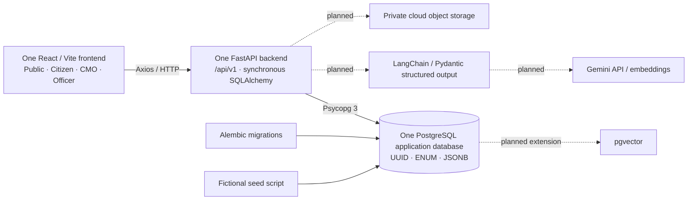

# System architecture

Solid edges are implemented. Dashed edges are future integrations; there are no Gemini calls,
vector extension/indexes, file endpoints or storage SDKs in Phase 1.

## Backend boundaries

core contains settings, structured application logging and Argon2id password helpers.
db contains DeclarativeBase/naming conventions, reusable UUID/timestamp mixins, the synchronous
engine/session lifecycle and complete model registry. Domain models live in their module folders.
main registers health, authentication/profile, citizen grievance and public department endpoints
through an application factory.
Auth now owns its models, schemas, transaction services, cookie/CSRF helpers and router. Core owns
strict JWT/password utilities, current-user/role dependencies and assignment authorization helpers.
Future modules will add workflow code when features exist; no empty layered boilerplate.

Settings read backend/.env and process environment. Engines connect lazily, use pre-ping,
a bounded connection timeout and UTC sessions. One request gets one session; the context manager
closes it and rolls back uncommitted work. Services will explicitly commit complete transactions.
No schema creation occurs on startup. Alembic is authoritative.

Application logs contain UTC timestamps, severity, logger and messages. Error responses are generic.
Database checks do not expose credentials/SQL. Production deployment still needs HTTPS, hosting
configuration, restricted DB credentials and environment-specific secrets.

## Frontend boundaries

app owns React Router and providers. Four layouts contain a disclaimer and nested Outlet.
A shared neutral placeholder keeps route replacement simple. Axios has an environment base URL,
10-second timeout and a stable error-message foundation. No token interception or login state exists.
Tailwind 4 uses the [official Vite plugin integration](https://tailwindcss.com/docs/installation/using-vite).

## Implemented authorization foundation and planned workflows

CITIZEN accesses owned records and public updates. CMO_ADMIN reviews, forwards and approves decisions.
DEPARTMENT_OFFICER sees active department assignments; a specifically assigned officer alone may
modify them, while other department officers have read-only access. Unassigned department work
may be updated by authorized active officers of that department. These assignment rules are now
implemented inside locked Phase 4 workflow transactions. Role-only dependencies do not grant
assignment access; officer resource queries also constrain current department and active assignment.

Every protected request verifies its access JWT and queries the current PostgreSQL user/session.
Fifteen-minute access tokens are not sufficient on their own: revoked/expired sessions and inactive
users fail immediately. Seven-day refresh sessions have absolute expiry; row-level locks serialize
rotation, record consumed JTI digests and commit replay revocation before returning 401.
Logout revokes session state; logout-all serializes with login through user-row locking.
No revocation decisions depend on worker-local memory.

Phase 3 separates grievance routers/schemas, transaction services and ownership-scoped repository
queries. A shared choices module defines districts/categories; the history module owns audit
insertion and public-safe projections. Grievance/history creation commits as one transaction.
Reference uniqueness retries use SQLAlchemy savepoints; unrelated database failures are not retried.
Departments expose only active public records. CMO/officer routers now expose Phase 4 operations.

## Phase 4 responsibilities

cmo/router.py and officer/router.py handle typed HTTP contracts and existing role dependencies.
cmo/repository.py owns bounded listing, eager administrative detail, report filters and SQL
department scoping. cmo/service.py constructs explicit administrative DTOs and coordinates commit/
rollback; officer/service.py produces narrower departmental projections. analytics/service.py
uses database GROUP BY and filtered counts, never statewide in-memory officer filtering.
grievances/workflow.py owns the state machine, grievance-row locking, assignment validation,
operational audit updates, report submission/review, reopening/resume and escalation invariants.
Mutations build response DTOs before the single transaction commits; failures roll back all writes.
Lock order is grievance then report; pending-report and active-assignment partial unique indexes
are additional backstops. There is no background worker, scheduler or second session factory.

CMO internal updates have no department provenance. Officer internal updates link to their
assignment, allowing the current department to view only its own investigation notes. Legacy
internal notes without provenance stay CMO-only. Assignment notes never enter officer DTOs.
See [lifecycle diagram and policies](10_Administrative_Workflow.md).

See [Authentication](08_Authentication.md) for the Mermaid sequence diagram, claims, CSRF and
cookie policy. JWT validation follows the [PyJWT validation API](https://pyjwt.readthedocs.io/en/stable/api.html).

