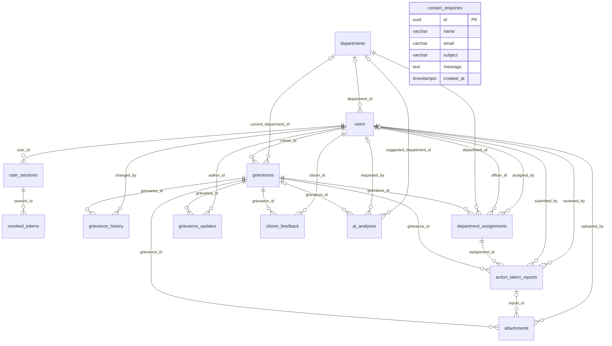

# Database design

PostgreSQL native UUID primary keys use Python uuid4 defaults. All timestamps are TIMESTAMPTZ.
Application and Alembic sessions use UTC; PostgreSQL stores instants independently of display timezone.
created_at defaults to now(); updated_at on users/grievances has ORM onupdate plus a DB trigger.
Required fields are non-null unless listed as optional. All foreign keys use ON DELETE RESTRICT.
No ORM delete cascades remove history or related evidence; use inactive flags for users/departments.

## Entities and columns

| Table | Key fields and content | Optional fields |
|---|---|---|
| users | id PK, name, unique email, password_hash, role, is_active, created_at, updated_at | mobile_number, department_id FK |
| departments | id PK, unique name, description, is_active, created_at | — |
| grievances | id PK, unique reference_number, citizen_id FK, district, category, subject, description, status, priority, created_at, updated_at | current_department_id FK, due_at, resolved_at |
| grievance_history | id PK, grievance_id FK, to_status, changed_by FK, remarks_visibility, created_at | from_status, remarks |
| department_assignments | id PK, grievance_id FK, department_id FK, assigned_by FK, assigned_at | officer_id FK, assignment_note, closed_at |
| grievance_updates | id PK, grievance_id FK, author_id FK, message, visibility, created_at | — |
| action_taken_reports | id PK, grievance_id FK, assignment_id FK, submitted_by FK, report_details, review_status, submitted_at | reviewed_by FK, review_remarks, reviewed_at |
| attachments | id PK, grievance_id FK, uploaded_by FK, unique storage_key, original_filename, content_type, file_size, created_at | report_id FK |
| citizen_feedback | id PK, grievance_id FK, citizen_id FK, reopen_requested, created_at | rating, comments |
| contact_enquiries | id PK, name, email, subject, message, created_at | — |
| ai_analyses | id PK, model_name, analysis_type, created_at | grievance_id FK, requested_by FK, suggested_department_id FK, suggested_category, suggested_priority, summary, reasoning, result_data JSONB |
| user_sessions | id PK, user_id FK, unique current_refresh_jti_hash, created_at, expires_at | last_used_at, revoked_at, revocation_reason |
| revoked_tokens | id PK, session_id FK, unique token_jti_hash, token_type, expires_at, revoked_at, reason | - |

## Native enums

- user_role: CITIZEN, CMO_ADMIN, DEPARTMENT_OFFICER.
- grievance_status: SUBMITTED, UNDER_REVIEW, IN_PROGRESS, RESOLVED, REOPENED.
- priority: LOW, MEDIUM, HIGH.
- update_visibility: PUBLIC, INTERNAL.
- review_status: PENDING, ACCEPTED, RETURNED.

AI priority suggestions and approved grievance priority share the enum but occupy separate columns.
AI output never automatically changes official grievance values. Multiple analyses, reports,
assignments and feedback submissions preserve the planned investigation history.

## Relationships (actual foreign keys)

All relationships are bidirectional, with explicit foreign_keys for ambiguous user/report links.
No FK targets contact_enquiries; it is an independent intake table.

## Constraints, integrity additions and indexes

- User role/department check: officers require a department; citizen/admin department must be null.
- Unique lowercase email avoids case-variant duplicate logins. Future intake must normalize email.
- Unique department name, grievance reference and storage key. Unique constraints already provide
  B-tree indexes: no redundant indexes on email or reference.
- Grievances: citizen, status, creation time, current department and (district, status) indexes.
- Assignment: grievance and officer indexes; partial index on department for active work;
  **unique partial index on grievance_id WHERE closed_at IS NULL**.
- History: (grievance_id, created_at) index; a PostgreSQL trigger rejects UPDATE, DELETE and TRUNCATE.
  Official transitions must later be inserted in the same transaction as status changes.
- Updates: (grievance_id, created_at) index.
- Reports: assignment index and (grievance_id, review_status) index; PENDING has no reviewer/time;
  ACCEPTED/RETURNED require reviewer/time. Review cannot precede submission.
- Assignments cannot close before assignment time. Attachments require nonnegative file_size.
- Feedback rating is null or 1–5; no unique grievance constraint limits historical submissions.
- Attachments index grievance/report; feedback and AI analyses index grievance.

Meaningful additions to the supplied schema are checks for normalized email, closure/review
chronology and review metadata, storage-key uniqueness, append-only history enforcement and DB
updated_at triggers. They add integrity without new business tables.

## Hybrid assignment

A department is mandatory; officer is nullable. Null means department-level assignment.
On reassignment the workflow service closes the current assignment and inserts its replacement in
one transaction, preserving the old row. It updates current_department_id in that transaction.
The partial unique index protects races.

## Transactional service validation

Check actor role and active status, department activation, officer membership, citizen ownership,
report grievance/assignment consistency, attachment grievance/report consistency and feedback
ownership. Enforce allowed state transitions and CMO-only approval; filter INTERNAL updates from
citizen APIs. These cross-record rules are enforced by Phase 3/4 transactional services, not merely
by FKs. Upload/report attachment consistency and feedback ownership remain future-service work.

References use CMK-<UTC year>-<16 uppercase hex characters> (64 random bits), e.g.
CMK-2026-A7F29C810D59E246. The database enforces uniqueness. The implemented submission service
retries only uq_grievances_reference_number failures inside savepoints, at most five attempts.
Other integrity failures roll back the request. Grievance plus initial audit event commit together.

## Migration

0001 creates exactly eleven domain tables, five shared native enum types, indexes, FKs, checks and
three triggers/two functions. Shared enums are explicitly created once. Downgrade removes tables
in reverse dependency order, then functions and enum types. alembic_version is migration
bookkeeping, not a domain entity. PostgreSQL upgrade/down/upgrade and metadata comparison
are covered by integration tests. Triggers are maintained explicitly in migrations, not autogeneration.

## Phase 2 migration 0002

Adds exactly two tables; all eleven original tables and migration 0001 remain unchanged.
User.sessions, UserSession.user/revoked_tokens and RevokedToken.session are bidirectional.
FKs use RESTRICT. JWT strings and raw JTIs are never persisted. SHA-256 hashes protect the
256-bit random JTI values (passwords continue to use Argon2id).

user_sessions has unique current_refresh_jti_hash, an expires_at index, and a partial index on
user_id WHERE revoked_at IS NULL. Checks enforce a 64-character digest, expiry after creation
and consistent revocation timestamp/reason. revoked_tokens has globally unique token_jti_hash,
session/expiry indexes, a digest-length check and token_type restricted to access/refresh.
The string/check token type avoids adding another native enum.

Consumed refresh identifiers remain recorded until expiry so replay can be detected.
Normal access invalidation uses session revocation; targeted access blacklist entries are supported
and checked. Cleanup is not scheduled in Phase 2; future maintenance can prune expired records
with child-before-parent ordering. Downgrading to 0001 removes only auth tables/indexes and
discards session state, preserving original users/departments/grievances.

## Phase 3 migration 0003 and query behavior

Adds grievance_history.remarks_visibility (the existing update_visibility ENUM) with a non-null
INTERNAL default. There are no new tables or enum types. Historical remark text is preserved
and remains private; no heuristic reclassifies old administrative text as public.
Initial system submission remarks are explicitly inserted as PUBLIC.
All official status transitions appear in timelines, but SQL CASE returns null for private remarks;
PUBLIC updates are selected separately in SQL. Only safe actor role labels are returned.
The same public-safe schema is used by generic CMO reads; /cmo endpoints use separate rich DTOs.

The append-only trigger still prohibits changing history, including its visibility, through DML.
Choose visibility when inserting a future transition; publish an approved public update separately
if necessary. Downgrade removes only the visibility column, preserving every audit record and the
shared enum owned by 0001. Prior migration files remain unchanged.

District/category columns remain VARCHAR to preserve legacy data; centralized StrEnums in
grievances/choices.py enforce canonical values on new API submissions and filters and can be
reused in future AI structured outputs. AI suggestions do not modify official fields.

Existing indexes support citizen/status/date queries, unique reference lookup and history/update
timelines. Listing uses SQL COUNT, ownership predicates, LIMIT/OFFSET and allowlisted sort columns
with UUID tie-breaking. Detail loads the department in one join; history/update projections join
actor roles in a fixed number of queries. Tests assert database pagination and constant query counts
as related data grows. No speculative extra index was added.

